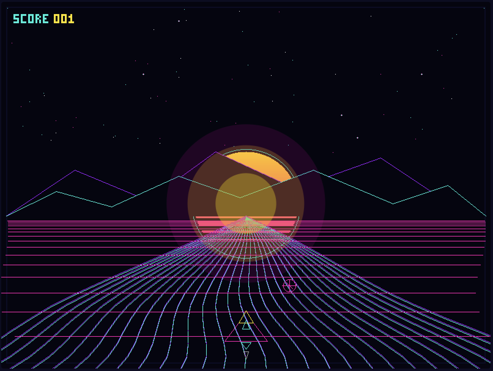

# Godom — A Go WebAssembly DOM Utility Library

`godom` is a dependency-free wrapper around the browser DOM and Canvas 2D APIs, written in pure Go. It targets standard WebAssembly (`GOOS=js GOARCH=wasm`) via Go 1.27's `syscall/js` layer.

Use it to build interactive browser apps entirely in Go — declarative element building, pixel-level canvas drawing, event handling, and audio pre-rendering, with no JavaScript frameworks required.  This is one of the tools I use for [commercial work](https://nofuss.co.za/webassembly-performance-consulting/) when I use Web Assembly to address bottlenecks in web applications. For example, the [retirement drawdown calculator](https://nofuss.co.za/tools/drawdown/) I have on my site is built using GoDom!

---



---

## Prerequisites

- **Go 1.27** or later
- **Node.js** (for running tests and the included demo — see [`DEVELOPER.md`](DEVELOPER.md))

---

## Installation

To import the library packages in your own Go WebAssembly project:

```bash
go get github.com/ewaldhorn/godom
```

---

## Basic Usage

Create a `main.go` file inside your project:

```go
package main

import (
	"github.com/ewaldhorn/godom/dom"
	"github.com/ewaldhorn/godom/html"
)

func main() {
	// Initialize the DOM handles (captures document, body, and head)
	dom.Init()

	// Declaratively build elements in a chainable hierarchy
	_ = html.Div().
		Class("container").
		Child(html.H1().Text("Hello World!").Build()).
		Child(html.P().Text("Rendering using Go WebAssembly.").Build()).
		AppendTo(dom.Body)

	// Block forever — Go's WASM runtime exits as soon as main() returns,
	// which would tear down all event listeners and animation callbacks.
	select {}
}
```

---

## Compilation

Build your application to WebAssembly using the standard Go compiler target:

```bash
GOOS=js GOARCH=wasm go build -o app.wasm main.go
```

---

## Serving & Loading in JS

1. Locate and copy `wasm_exec.js` from your Go installation:
   ```bash
   cp "$(go env GOROOT)/lib/wasm/wasm_exec.js" .
   ```
   > On older Go installations the file may be at `$(go env GOROOT)/misc/wasm/wasm_exec.js` instead.

2. Load the WebAssembly module inside your `index.html` page:

```html
<!DOCTYPE html>
<html>
  <head>
    <meta charset="utf-8" />
    <script src="wasm_exec.js"></script>
  </head>
  <body>
    <!-- Container for the canvas — the id must match the parentID passed to canvas.NewCanvas -->
    <div id="app"></div>
    <div id="loading">Loading App...</div>
    <script>
      const go = new Go();
      WebAssembly.instantiateStreaming(fetch("app.wasm"), go.importObject).then((result) => {
        document.getElementById("loading").remove();
        go.run(result.instance);
      }).catch(err => {
        console.error("Failed to load WASM:", err);
      });
    </script>
  </body>
</html>
```

> **Browser support:** WebAssembly is supported in all modern browsers (Chrome, Firefox, Safari, Edge). You must serve files over HTTP — opening `index.html` directly as a `file://` URL will not work.
>
> **Note:** `synth-worklet.js` (in `docs/`) is only required for the demo's audio synthesizer and is not part of the library itself.

---

## Canvas

The `canvas` package provides a pixel buffer and drawing primitives implemented in pure Go. Draw to the `pixels []byte` slice you passed into `NewCanvas`, then call `Render()` to blit to the browser in one shot:

```go
import (
	"github.com/ewaldhorn/godom/canvas"
	"github.com/ewaldhorn/godom/colour"
)

pixels := make([]byte, 320*240*4)
// The last argument is the ID of an existing HTML element to attach the canvas to.
c := canvas.NewCanvas(320, 240, pixels, "app")

c.ClearScreen(colour.Black)
c.SetColour(colour.White)
c.Line(10, 10, 100, 100)
c.FilledCircle(160, 120, 50)
c.Rectangle(200, 50, 80, 60, 2)
c.Render()
```

> **Note:** `NewCanvas` appends a `<canvas>` element to the DOM element whose `id` matches the `parentID` argument (`"app"` above). Make sure that element exists in your `index.html` before the WASM module runs.

#### Drawing primitives

Each primitive has two forms. The **plain** form uses the active colour set by `SetColour`. The **`Colour*`** form takes a `colour.Colour` argument, letting you pass a colour inline without a separate `SetColour` call:

| Plain | Colour variant | Description |
|---|---|---|
| `PutPixel(x, y int32)` | `ColourPutPixel(x, y int32, col Colour)` | Single pixel |
| `GetPixel(x, y int32) (Colour, bool)` | — | Read pixel; `false` if out of bounds |
| `Line(x1, y1, x2, y2 int32)` | `ColourLine(...)` | Bresenham line |
| `LinePoint(p1, p2 Point)` | `ColourLinePoint(...)` | Line between two `Point` values |
| `Circle(midX, midY, radius int32)` | `ColourCircle(...)` | Outline circle |
| `FilledCircle(midX, midY, radius int32)` | `ColourFilledCircle(...)` | Filled circle |
| `BorderCircle(midX, midY, radius, borderWidth int32)` | `ColourBorderCircle(...)` | Ring / annulus |
| `Rectangle(x, y, w, h, thickness int32)` | `ColourRectangle(...)` | Outline rectangle |
| `FilledRectangle(x, y, w, h int32)` | `ColourFilledRectangle(...)` | Filled rectangle |
| `Triangle(p1, p2, p3 Point)` | — | Wireframe triangle |

`Point` is a simple struct `{ X, Y int32 }` defined in the `canvas` package.

---

## Events

Register event listeners on `dom.Window`, `dom.Document`, any `dom.Handle`, or any `html.Element` builder using plain Go functions (no `syscall/js` required):

```go
import (
	"github.com/ewaldhorn/godom/dom"
	"github.com/ewaldhorn/godom/html"
)

// On a builder:
btn := html.Button().
	Text("Click me").
	OnClick(func() {
		dom.Alert("clicked!")
	}).
	AppendTo(dom.Body)

// On the window or any element handle (with access to event properties):
off := dom.Window.OnEvent("mousedown", func(e dom.Event) {
	e.PreventDefault()
	x, y := e.ClientX(), e.ClientY()
	_ = x
	_ = y
})
_ = off // call off() to remove the listener and release the JS callback
```

The `dom` package also provides `OnByID`, `OnEventByID`, and `OnClickByID` for looking up elements by ID, plus `StartLoop` for `requestAnimationFrame` rendering:

```go
import (
	"github.com/ewaldhorn/godom/canvas"
	"github.com/ewaldhorn/godom/colour"
	"github.com/ewaldhorn/godom/dom"
)

func main() {
	dom.Init()

	pixels := make([]byte, 300*300*4)
	c := canvas.NewCanvas(300, 300, pixels, "app")

	var x, y int32 = 150, 150
	var dx, dy int32 = 2, 2
	red := colour.Colour{R: 255, G: 0, B: 0, A: 255}

	dom.StartLoop(func() {
		// Update position and bounce off walls
		x += dx
		y += dy
		if x <= 20 || x >= 280 { dx = -dx }
		if y <= 20 || y >= 280 { dy = -dy }

		// Draw
		c.ClearScreen(colour.Black)
		c.ColourFilledCircle(x, y, 20, red)
		c.Render()
	})

	select {}
}
```

---

## Packages

| Package | Purpose |
|---------|---------|
| **`dom`** | Global handles (`Document`, `Body`, `Head`). Element CRUD: `CreateElement`, `GetElementByID`, `AddElementTo`. Visibility: `Hide`, `Show`. Events: `AddEventListener`, `StartAnimationLoop`. Canvas bootstrap: `CanvasCreate`, `CanvasGetContext`, `Context2D` wrapper. Utilities: `AddNewStyleElement`, `Log`, `Alert`. |
| **`html`** | Fluent tag builder for `Div`, `Span`, `Button`, `Input`, `Form`, `Table`, `H1`–`H6`, `Ul`/`Ol`/`Li`, `A`, `Img`, `Br`, `Hr`, and more. Chainable: `.Class()`, `.ID()`, `.Text()`, `.HTML()`, `.Attr()`, `.Child()`, `.On()`, `.AppendTo()`, `.Build()`. |
| **`canvas`** | Pixel canvas with a Go-side `[]byte` buffer. Draw with `Line`, `Circle`, `FilledCircle`, `BorderCircle`, `Rectangle`, `FilledRectangle`, `Triangle`, `PutPixel`, `GetPixel`, then commit everything to the browser in one call with `Render()`. Every drawing primitive has a `Colour*` variant that takes a colour inline. |
| **`colour`** | RGBA struct with presets (`White`, `Black`, `Empty`). `IsEmpty()`, `ConvertToGrayscale()`. Seedable PRNG: `RandomColour()`, `Seed()`. Construct custom colours as `colour.Colour{R: 255, G: 0, B: 0, A: 255}`. |
| **`sound`** | Audio pre-rendering: `FillClick` generates a triangle-wave click buffer suitable for low-latency browser playback via the Web Audio API. |

> **Note:** `dom.Handle.Get` and `dom.GetString` return an empty string when the requested property is missing — and `GetString` also returns `""` when the element does not exist. They never return the literal JS string `"undefined"`.

---

## Running the Included Demo

This repository includes a feature-rich, high-performance synthwave physics and audio sequencer demo.

### Prerequisites
* Go 1.27 or later
* Node.js (used by `run.sh` via `npx http-server` to serve the demo)

### Build & Run
1. Make the scripts executable (if not already):
   ```bash
   chmod +x build.sh run.sh
   ```
2. Build the Go WASM demo:
   ```bash
   ./build.sh
   ```
3. Start the local development server:
   ```bash
   ./run.sh
   ```
4. Open your browser and navigate to `http://localhost:9000`.

### Demo Features
* **Canvas One:** Interactive synthwave render running Bresenham line and circle algorithms.
* **Canvas Two:** Real-time elastic ball physics simulation updating at 60 FPS.
* **Canvas Three:** Neo-neon 16-step drum machine sequencer with AudioWorklet synthesizer loops.

---

## Examples

The [`examples/`](examples/) directory contains self-contained projects showing how to use `godom` in practice.

### `click-rect` — Interactive canvas with click detection

A 300×300 canvas with a blue rectangle centered in it. Clicking or tapping the rectangle toggles it between blue and white. Demonstrates:
- Setting up a canvas with `canvas.NewCanvas`
- Drawing with `ColourFilledRectangle`
- Registering a click handler with `dom.AddEventListenerByID`
- Reading mouse coordinates from the JS event (`args[0].Get("offsetX").Int()`)
- Hit-testing pixel coordinates against a rectangle

**Build and run:**
```bash
cd examples/click-rect
chmod +x build.sh && ./build.sh
npx http-server . -p 9001
```
Then open `http://localhost:9001`.

---

## Tutorials

I also have some basic tutorials I'm working on in the [`conversions/`](conversions) directory that you might want to check out at some point. These are a WIP so check back now and then.

---

## Benchmarking

The `benchmarks/` directory contains the code used to validate key performance decisions in this library — for example, the exponential copy strategy behind `ClearScreen()` which is ~22× faster than a naive pixel loop at 1920×1080.

See [`benchmarks/README.md`](benchmarks/README.md) for the results and what they mean for your usage.

---

## Further Reading

| Document | What's in it |
|---|---|
| [`DEVELOPER.md`](DEVELOPER.md) | Full API reference, package internals, testing & benchmark workflow for contributors |
| [`benchmarks/README.md`](benchmarks/README.md) | Performance results and practical guidance for library users |
| [`examples/`](examples/) | Self-contained runnable example projects |
