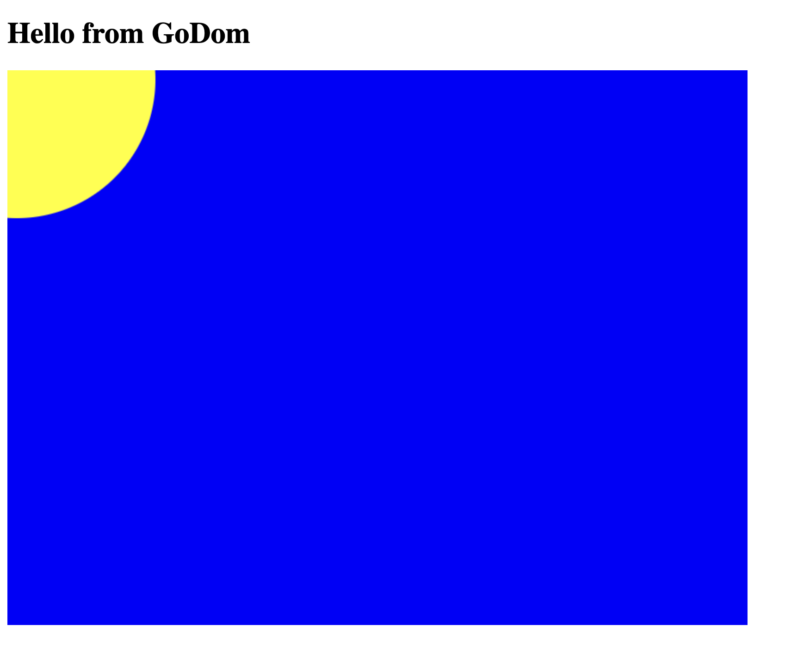

# Step 2

Now that we have a basic Go project configured and runnable, we can look into how we will be able to issue Canvas draw commands using GoDom.

## First things first

Let's edit our `index.html` and remove the header and update the title, like this:

```html
<!DOCTYPE html>
<html>
  <head>
    <meta charset="utf-8" />
    <title>GoDom Tutorial Step 2</title>
    <script src="wasm_exec.js"></script>
  </head>
  <body>
      <script>
        const go = new Go();
        WebAssembly.instantiateStreaming(fetch("app.wasm"), go.importObject).then((result) => {
          go.run(result.instance);
        }).catch(err => {
          console.error("Failed to load WASM:", err);
        });
      </script>
  </body>
</html>
```

## Getting the canvas configured

To be able to draw something, we need an HTML Canvas configured. So we could create a canvas element in our HTML page, but we can also ask Go to do that for us. Since we're trying to do as much Go as possible, let's do that.

In our `main.go`, we can create a new HTML Canvas element like this:

```go
func main() {
	// First step is to init the dom
	dom.Init()

	// now we can create elements
	// we won't need the actual container so we ignore the variable
	_ = html.Div().Class("container").Child(html.H1().Text("Hello from GoDom").Build()).AppendTo(dom.Body)

	// create our canvas and draw to it
	context2d := createAndConfigureHTMLCanvas()
	drawToTheCanvas(context2d)

	// need to block this from exiting, otherwise wasm terminates our app
	select {}
}
```

I know, those functions don't exist yet, but we'll get to them in a second... First up, let's take a look at what `createAndConfigureHTMLCanvas` does:

```go
func createAndConfigureHTMLCanvas() dom.Context2D {
	// create a new Div container for our canvas
	canvasContainer := html.Div().Class("canvas-container")

	// create the actual canvas, set the attributes and background colour
	myCanvas := html.Canvas()
	myCanvas.Attr("width", "800")
	myCanvas.Attr("height", "600")
	myCanvas.Style("background-color", "blue")

	// apped the canvas to the container, then the container to the html body
	myCanvas.AppendTo(canvasContainer.Handle)
	canvasContainer.AppendTo(dom.Body)

	// return the Context2D handle, which is what we need to draw to the canvas
	return getContext2DfromCanvasHandle(myCanvas.Handle)
}
```

That's quite a beast, but, is it, really? We've already created a div container before, so that's not new. Creating an HTML Canvas element seems pretty straight-forward, you create the element, set some attributes and styles, pretty much like you'd do in JavaScript anyway. Then we just append the canvas to the container, the container to the HTML body and... Well, that's almost it. There's a funny `getContext2DfromCanvasHandle` function:

```go
func getContext2DfromCanvasHandle(canvasHandle dom.Handle) dom.Context2D {
	if !canvasHandle.IsValid() {
		panic("godom: getContext2DfromCanvasHandle received an invalid canvas handle")
	}

	return dom.NewContext2D(canvasHandle)
}
```
Oh, ok, well, that's not too bad, is it? Basically, check if we have a valid handle, then get a Context2D from it and return that.

Finally, we have the `` function:

```go
func drawToTheCanvas(ctx dom.Context2D) {
	ctx.FillStyle("yellow")
	ctx.Arc(10.0, 10.0, 150.0, 0.0, 180.0, false)
	ctx.Fill()
}
```

Now, if you've ever done JavaScript HTML Canvas drawing, this code should look pretty familiar! And that's what I tried to do with GoDom: Make it as close to the JavaScript code I'm used to write, just with a bit of a Go flavour mixed in.

If you run this, you should get:


