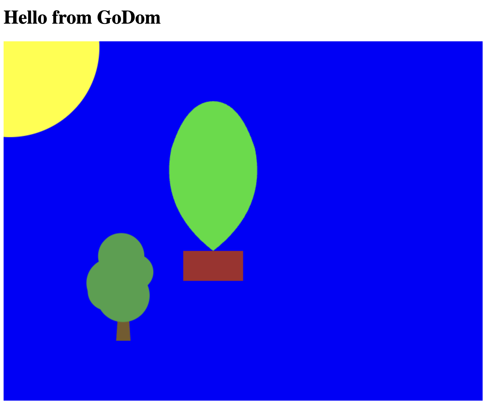

# Step 3

With basic canvas rendering handled, we can start diving deeper into the actual game code.

## Time to update the index page

Let's edit our `index.html` to reflect where we are now:

```html
<!DOCTYPE html>
<html>
  <head>
    <meta charset="utf-8" />
    <title>GoDom Tutorial Step 3</title>
    <script src="wasm_exec.js"></script>
  </head>
  <body>
      <script>
        const go = new Go();
        WebAssembly.instantiateStreaming(fetch("app.wasm"), go.importObject).then((result) => {
          go.run(result.instance);
        }).catch(err => {
          console.error("Failed to load WASM:", err);
        });
      </script>
  </body>
</html>
```

## We're gonna need random numbers

One of the things I use a lot in my games, is random numbers. Now I know there are tons of different ways to solve this problem, but there's a particular solution I quite like: SplitMix64. You can read up on it at [RosettaCode Pseudo-random numbers](https://rosettacode.org/wiki/Pseudo-random_numbers/Splitmix64). The reason I like this method is that I can, when I need to, make it deterministic. For example, in this project, I want trees to be "random" but that randomness must be deterministic. That'll make sense when you see the game rendering, I hope.

For now, let's introduce a new Go source file called `rng.go`:

```go
package main

// For the trees, I wanted each tree to look random, but I wanted that randomness to be tied to
// the tree height. That way, I can have trees render at any xy position, but their look is
// determined by their height. So it's sort of deterministic.
//
// I used https://rosettacode.org/wiki/Pseudo-random_numbers/Splitmix64 as a reference for building
// this. It's something I've been using since my Java days!

// ------------------------------------------------------------------------------------------------
type rng struct{ s uint64 }

// ------------------------------------------------------------------------------------------------
func newRNG(seed uint64) *rng {
	return &rng{s: seed}
}

// ------------------------------------------------------------------------------------------------
// next uses the golden ration (0x9E3779B97F4A7C15) to advance the seed and generated the next
// random number. Basically, this is SplitMix64, which is pretty cool for games. I tend to use
// it quite often because it's lightweight but efficient. Don't build your crypto exchange on it
// though, unless you want to get famous for the wrong reasons!
func (r *rng) next() uint64 {
	r.s += 0x9E3779B97F4A7C15
	z := r.s
	z = (z ^ (z >> 30)) * 0xBF58476D1CE4E5B9
	z = (z ^ (z >> 27)) * 0x94D049BB133111EB
	return z ^ (z >> 31)
}

// ------------------------------------------------------------------------------------------------
func (r *rng) float64() float64 {
	return float64(r.next()>>11) / float64(1<<53)
}

// ------------------------------------------------------------------------------------------------
func (r *rng) intn(n int) int {
	return int(r.next() % uint64(n))
}
```

If you like, you can go read up more about how this works, but for now, all you need to know is that we can create a random number generator and ask it for a float64 or int value and it is deterministic.

## Drawing a balloon

Right, the next thing we'll need is to render a balloon to the canvas. I've created a new file called `balloon.go` (I'm brilliant at naming things):

```go
package main

import (
	"github.com/ewaldhorn/godom/dom"
)

// ------------------------------------------------------------------------------------------------
const (
	BASKET_WIDTH      = 100
	BASKET_HALF_WIDTH = BASKET_WIDTH / 2
	BASKET_HEIGHT     = 50
)

// ------------------------------------------------------------------------------------------------
func drawBalloon(x, y float64, ctx dom.Context2D) {

	// first we render the basket
	ctx.FillStyle("brown")
	ctx.FillRect(x-BASKET_HALF_WIDTH, y, BASKET_WIDTH, BASKET_HEIGHT)

	// now the balloon
	ctx.FillStyle("#28DD28")
	ctx.BeginPath()
	ctx.MoveTo(x, y)                               // middle of the balloon
	ctx.QuadraticCurveTo(x-90, y-70, x-70, y-170)  // bottom-left
	ctx.QuadraticCurveTo(x-45, y-250, x, y-250)    // top-left to apex
	ctx.QuadraticCurveTo(x+45, y-250, x+70, y-170) // apex to right
	ctx.QuadraticCurveTo(x+90, y-70, x, y)         // right down to middle
	ctx.ClosePath()
	ctx.Fill()
}
```

Essentially, it uses Canvas drawing operations to draw a, well, balloon! Notice how it's just Go code, nothing special and that it follows the same conventions you'd use when you write it in JavaScript. The whole idea behind GoDom is to keep it as simple as possible while sticking as close to the JavaScript was as makes sense.

## We need a forest

Yeah yeah, we do, but, err, let's start with a tree first. This is where we're going to use our fancy deterministic random number generator (rng) to create pseudo-random trees. In a file called `tree.go`, put this code:

```go
package main

import (
	"math"

	"github.com/ewaldhorn/godom/dom"
)

// ------------------------------------------------------------------------------------------------
func drawTrunk(x, y, h float64, ctx dom.Context2D) {
	// (x, y) = bottom-center of trunk, h = trunk height
	baseHalf := h * 0.12 // half-width at the base
	topHalf := h * 0.06  // half-width at the top

	ctx.FillStyle("#775A29")
	ctx.BeginPath()

	// bottom-left
	ctx.MoveTo(x-baseHalf, y)

	// left edge curving inward toward the top
	ctx.QuadraticCurveTo(
		x-baseHalf*0.7, y-h/2, // control point
		x-topHalf, y-h, // top-left corner
	)

	// top edge
	ctx.LineTo(x+topHalf, y-h)

	// right edge curving back down
	ctx.QuadraticCurveTo(
		x+baseHalf*0.7, y-h/2, // control point
		x+baseHalf, y, // bottom-right
	)

	ctx.ClosePath()
	ctx.Fill()
}

// ------------------------------------------------------------------------------------------------
func drawLeaves(x, y, h float64, ctx dom.Context2D) {
	// The seed. Any change to h produces a different tree.
	r := newRNG(math.Float64bits(h))

	// Canopy geometry, expressed as fractions of h so it scales nicely.
	cx := x
	cy := y - h*1.05 // centre of canopy, just above the trunk's top
	spread := h * 0.55

	// Optional: same-h trees always pick the same shade.
	greens := []string{"#2E7D32", "#388E3C", "#43A047", "#4CAF50"}
	shade := greens[r.intn(len(greens))]

	n := 6 + r.intn(5) // 6..10 blobs, but stable for a given h
	for i := 0; i < n; i++ {
		// Uniform-ish point in a disc (sqrt for even area distribution).
		ang := r.float64() * 2 * math.Pi
		dist := math.Sqrt(r.float64()) * spread
		bx := cx + math.Cos(ang)*dist
		by := cy + math.Sin(ang)*dist*0.85 // squash vertically

		br := spread * (0.45 + r.float64()*0.40)

		ctx.FillStyle(shade)
		ctx.BeginPath()
		ctx.Arc(bx, by, br, 0, 2*math.Pi, false)
		ctx.Fill()
	}
}

// ------------------------------------------------------------------------------------------------
// drawTree draws a single tree at the xy coordinate, with the given height.
// NGL this took me a bit of experimenting to get right, I left comments for my future self.
// I eventually broke it into sub-functions, because it became a bit much to manage.
func drawTree(x, y, h float64, ctx dom.Context2D) {
	drawTrunk(x, y, h, ctx)
	drawLeaves(x, y, h, ctx)
}
```

If you run this, you should get:


