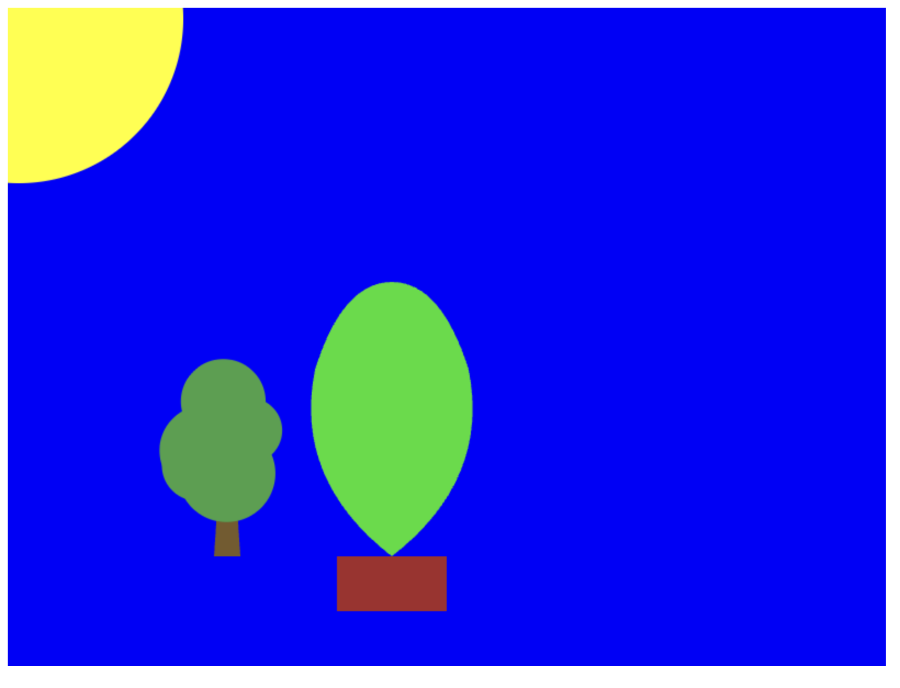

# Step 4

So we can render a balloon and a tree... Ok that's a start I guess!

## Update the index page

Let's edit our `index.html`, you know the drill by now:

```html
.
.
  <head>
    <meta charset="utf-8" />
    <title>GoDom Tutorial Step 4</title>
    <script src="wasm_exec.js"></script>
  </head>
  .
  .
```

## We need some interaction

Ok so we have our balloon, just, sitting there. That's no fun. We need a way to make this interactive. Since it's the web, we should support mouse clicks, a button press and a touch event. The idea is to make the balloon climb when one of these events occur and then have it slowly drift down again by itself. We'll worry about latteral movement (is that a word?!) later, for now, we just want to get interaction going.

## First things first

Ok so before we even bother with interaction, we need to get some basics in place. Right now, we don't have a handle to our canvas, so we can't register event listeners on it anyway. Also, our balloon is rendered, once, at a static position. We need to make the position variable and refresh it on every browser animation refresh call.  We'll start with getting a handle on our canvas.

In `main.go`, in the `createAndConfigureHTMLCanvas` function, we'll make some small changes. We need to change the function return type so that it returns a handle to the canvas as well, not just the 2D context. And then we must of course return it:

```go
func createAndConfigureHTMLCanvas() (html.Element, dom.Context2D) {
	// create a new Div container for our canvas
	canvasContainer := html.Div().Class("canvas-container")

	// create the actual canvas, set the attributes and background colour
	myCanvas := html.Canvas()
	myCanvas.Attr("width", "800")
	myCanvas.Attr("height", "600")
	myCanvas.Style("background-color", "blue")

	// apped the canvas to the container, then the container to the html body
	myCanvas.AppendTo(canvasContainer.Handle)
	canvasContainer.AppendTo(dom.Body)

	// return the canvas and Context2D handles
	return myCanvas, getContext2DfromCanvasHandle(myCanvas.Handle)
}
```

With that done, we can update our `main` function next by updating what happens when we call this function we just modified:

```go
	// create our canvas and set up click interaction
	myCanvas, context2d := createAndConfigureHTMLCanvas()
```

We simply assign the handle we get back for the canvas to a variable. Ok that's good, we now have a handle to the canvas that we can, at some point, use to register event listeners to.

## To move things, you must change things

Our current balloon position is static. It's just rendered once, in one static position and can't be changed. This is clearly something that requires a bit of a rethink. Now that we've proven we can draw the balloon, it's time to make it a bit more flexible. Let's add a custom type in `balloon.go` that we can use to keep track of a balloon's position:

```go
type BalloonPosition struct {
	X, Y float64
}
```

For now, all we want to do is use this to figure out where to draw our balloon. So also update the `drawBalloon` function to take the balloon position as a parameter, so your `balloon.go` file should look something like this:

```go
package main

import (
	"github.com/ewaldhorn/godom/dom"
)

// ------------------------------------------------------------------------------------------------
type BalloonPosition struct {
	X, Y float64
}

// ------------------------------------------------------------------------------------------------
const (
	BASKET_WIDTH      = 100
	BASKET_HALF_WIDTH = BASKET_WIDTH / 2
	BASKET_HEIGHT     = 50
)

// ------------------------------------------------------------------------------------------------
func drawBalloon(pos BalloonPosition, ctx dom.Context2D) {

	// first we render the basket
	ctx.FillStyle("brown")
	ctx.FillRect(pos.X-BASKET_HALF_WIDTH, pos.Y, BASKET_WIDTH, BASKET_HEIGHT)

	// now the balloon
	ctx.FillStyle("#28DD28")
	ctx.BeginPath()
	ctx.MoveTo(pos.X, pos.Y)                                       // middle of the balloon
	ctx.QuadraticCurveTo(pos.X-90, pos.Y-70, pos.X-70, pos.Y-170)  // bottom-left
	ctx.QuadraticCurveTo(pos.X-45, pos.Y-250, pos.X, pos.Y-250)    // top-left to apex
	ctx.QuadraticCurveTo(pos.X+45, pos.Y-250, pos.X+70, pos.Y-170) // apex to right
	ctx.QuadraticCurveTo(pos.X+90, pos.Y-70, pos.X, pos.Y)         // right down to middle
	ctx.ClosePath()
	ctx.Fill()
}
```

What's changed is that `drawBalloon` now accepts the BalloonPosition instead of an XY coordinate pair. We could have stuck with the XY pair, but this just signals the intent a bit easier. Plus it's just one variable to pass in from the calling function.

## Speaking of calling function

Ah we've broken `main` with the change in the `drawBalloon` function signature. Since things are now getting a bit complicated, let's reorganise the `main.go` file a bit. We'll move the render operations into a function and then also, since we want animation, start a loop that uses the `requestAnimationFrame` function to drive the loop.

```go
package main

import (
	"github.com/ewaldhorn/godom/dom"
	"github.com/ewaldhorn/godom/html"
)

// ------------------------------------------------------------------------------------------------
var balloonPos = BalloonPosition{X: 350, Y: 500}

// ------------------------------------------------------------------------------------------------
const (
	canvasWidth  = 800
	canvasHeight = 600
)

// ------------------------------------------------------------------------------------------------
func drawGameBackground(ctx dom.Context2D) {
	ctx.ClearRect(0, 0, canvasWidth, canvasHeight)
	ctx.FillStyle("yellow")
	ctx.BeginPath()
	ctx.Arc(10.0, 10.0, 150.0, 0.0, 180.0, false)
	ctx.Fill()
}

// ------------------------------------------------------------------------------------------------
func renderScene(ctx dom.Context2D) {
	drawGameBackground(ctx)
	drawBalloon(balloonPos, ctx)
	drawTree(200, 500, 100, ctx)
}

// ------------------------------------------------------------------------------------------------
func main() {
	// First step is to init the dom
	dom.Init()

	// create our canvas and set up click interaction
	myCanvas, context2d := createAndConfigureHTMLCanvas()

	myCanvas.OnEvent("mousedown", func(e dom.Event) {
		balloonPos.Y -= 5
	})

	// draw once per browser animation frame
	stopLoop := dom.StartLoop(func() {
		renderScene(context2d)
	})
	defer stopLoop()

	// need to block this from exiting, otherwise wasm terminates our app
	select {}
}
```

You might notice that `main.go` looks a bit different now...  I've moved some of the helper functions into `main_helpers.go` just to make `main.go` a bit shorter and easier to navigate.  The `main_helpers.go` looks like this:

```go
package main

import (
	"github.com/ewaldhorn/godom/dom"
	"github.com/ewaldhorn/godom/html"
)

// ------------------------------------------------------------------------------------------------
func getContext2DfromCanvasHandle(canvasHandle dom.Handle) dom.Context2D {
	if !canvasHandle.IsValid() {
		panic("godom: getContext2DfromCanvasHandle received an invalid canvas handle")
	}

	return dom.NewContext2D(canvasHandle)
}

// ------------------------------------------------------------------------------------------------
func createAndConfigureHTMLCanvas() (html.Element, dom.Context2D) {
	// create a new Div container for our canvas
	canvasContainer := html.Div().Class("canvas-container")

	// create the actual canvas, set the attributes and background colour
	myCanvas := html.Canvas()
	myCanvas.Attr("width", "800")
	myCanvas.Attr("height", "600")
	myCanvas.Style("background-color", "blue")

	// apped the canvas to the container, then the container to the html body
	myCanvas.AppendTo(canvasContainer.Handle)
	canvasContainer.AppendTo(dom.Body)

	// return the canvas and Context2D handles
	return myCanvas, getContext2DfromCanvasHandle(myCanvas.Handle)
}
```

We can now run our game and we should see it render. When you click the mouse a few times, the balloon will move. There are no sanity checks on the movement yet, and no real animation, but we have registered an event handler, tapped into the browser animation loop and cleaned up our code somewhat. I'd say we are making good progress.

You should get this in your browser:



I've removed the header we weren't using as well.

## Step 4 is done, Step 5 awaits

When you are ready for it, Step 5 awaits:  [Step 5](../step_5/)
