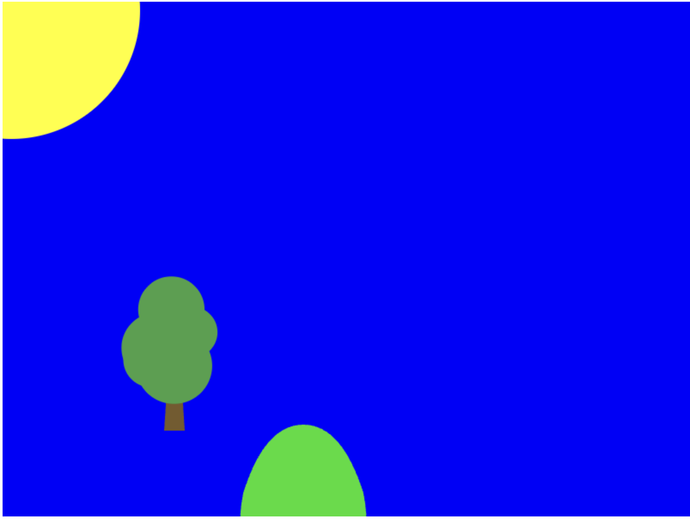

# Step 5

We now have the ability to register event handlers. That's pretty handy! How can we use this to start putting some things together for our game? I think the first step is going to be to set some kind of flag for when the balloon is rising due to a tap, click, button-press etc.

## Update the index page

Let's edit our `index.html`, you know the drill by now:

```html
.
.
  <head>
    <meta charset="utf-8" />
    <title>GoDom Tutorial Step 5</title>
    <script src="wasm_exec.js"></script>
  </head>
  .
  .
```

## Add a flag for a rising balloon

We need to make it so the balloon rises when the player interacts with it. The easiest way to do it is to set a flag that is true when the balloon must rise, and false when the input is no longer active.

In the `balloon.go` file, we can add the flag to the `BalloonPosition` type:

```go
type BalloonStatus struct {
	X, Y     float64
	IsRising bool
}
```

Since it's now not used for just position anymore, I changed the type name to `BalloonStatus`. With that done, we could probably go ahead and register our event handlers for the mouse (up and down) and have them toggle the flag. But first, let's make sure we can also support touch events. To do that, we should set the `touch-action` style property on our canvas. In `main_helpers.go` in the `createAndConfigureHTMLCanvas` function, add a line to do this:

```go
myCanvas.Style("touch-action", "none")
```

So your function should now read as:

```go
func createAndConfigureHTMLCanvas() (html.Element, dom.Context2D) {
	// create a new Div container for our canvas
	canvasContainer := html.Div().Class("canvas-container")

	// create the actual canvas, set the attributes and background colour
	myCanvas := html.Canvas()
	myCanvas.Attr("width", "800")
	myCanvas.Attr("height", "600")
	myCanvas.Style("background-color", "blue")
	myCanvas.Style("touch-action", "none")

	// apped the canvas to the container, then the container to the html body
	myCanvas.AppendTo(canvasContainer.Handle)
	canvasContainer.AppendTo(dom.Body)

	// return the canvas and Context2D handles
	return myCanvas, getContext2DfromCanvasHandle(myCanvas.Handle)
}
```

Now we'll be able to properly support touch events as well. Modern browsers have unified these into pointer events, so we will use those. I'm going to create another helper container file called `main_event_handlers.go` to keep the event handlers together.

```go
package main

import (
	"github.com/ewaldhorn/godom/dom"
	"github.com/ewaldhorn/godom/html"
)

func isSpaceKey(e dom.Event) bool {
	return e.Code() == "Space" || e.Key() == " "
}

func registerCanvasEventHandlers(canvas html.Element) {
	var pointerDown, spaceDown bool

	syncRising := func() {
		balloonPos.IsRising = pointerDown || spaceDown
	}

	stopPointer := func() {
		pointerDown = false
		syncRising()
	}

	canvas.OnEvent("pointerdown", func(e dom.Event) {
		if e.Button() != 0 {
			return
		}
		e.PreventDefault()
		pointerDown = true
		syncRising()
	})

	canvas.OnEvent("contextmenu", func(e dom.Event) {
		e.PreventDefault()
		stopPointer()
	})

	canvas.Handle.On("pointerleave", stopPointer)
	dom.Window.On("pointerup", stopPointer)
	dom.Window.On("pointercancel", stopPointer)

	dom.Window.OnEvent("keydown", func(e dom.Event) {
		if !isSpaceKey(e) {
			return
		}
		e.PreventDefault()
		spaceDown = true
		syncRising()
	})

	dom.Window.OnEvent("keyup", func(e dom.Event) {
		if !isSpaceKey(e) {
			return
		}
		e.PreventDefault()
		spaceDown = false
		syncRising()
	})

	dom.Window.On("blur", func() {
		pointerDown = false
		spaceDown = false
		syncRising()
	})
}
```

This is a bit more advanced and technical than the code we've used until now, in the sense that we are using the fact that Go allows us to declare functions inside functions... See how `syncRising` and `stopPointer` are functions we declare in the scope of our `registerCanvasEventHandlers` function? Since they are used nowhere else and operate only on the variables inside our function, this helps us make our function shorter and simpler to work with and debug.

In `isSpaceKey` we check whether a key pressed was the Spacebar, return true if that's the case. What `syncRising` does, is figure out whether we are holding the spacebar or a mouse button down, which is how the player makes the balloon rise. Now for each event that we are interested in, we register a listener and act on it. Even though it looks complicated, it's actually the same thing repeating over and over. Pretty neat actually!

Since we've given the balloon an `IsRising` flag, we can make some changes to Balloon to have it respond to this flag. We give Balloon an `Update` function:

```go
func (b *BalloonStatus) Update() {
	if b.IsRising {
		b.Y -= 1
	} else {
		b.Y += 1
	}
}
```

It simply makes the balloon go up when it's rising, otherwise it starts dropping. So let's get to `main.go` and make a few small changes. First, we will add an `updateScene` function:

```go
func updateScene() {
	balloonPos.Update()
}
```

This calls the balloon's update function each time the main loop runs. We can also simplify our `main` function a bit now:

```go
func main() {
	// First step is to init the dom
	dom.Init()

	// create our canvas and set up click interaction
	myCanvas, context2d := createAndConfigureHTMLCanvas()
	registerCanvasEventHandlers(myCanvas)

	// draw once per browser animation frame
	stopLoop := dom.StartLoop(func() {
		updateScene()
		renderScene(context2d)
	})
	defer stopLoop()

	// need to block this from exiting, otherwise wasm terminates our app
	select {}
}
```

We are using our new `registerCanvasEventHandlers` function and the `updateScene` function. When you now run the game at this point, you'll see the balloon immediately starting to drop as the game opens. Press spacebar or hold the mouse button to see the balloon rise.

You should get this in your browser:



If you run into issues, check your code against the repo, there might be something missing.

## Step 5 is done, Step 6 is next

Let's go to Step 6 when you are ready:  [Step 6](../step_6/)
