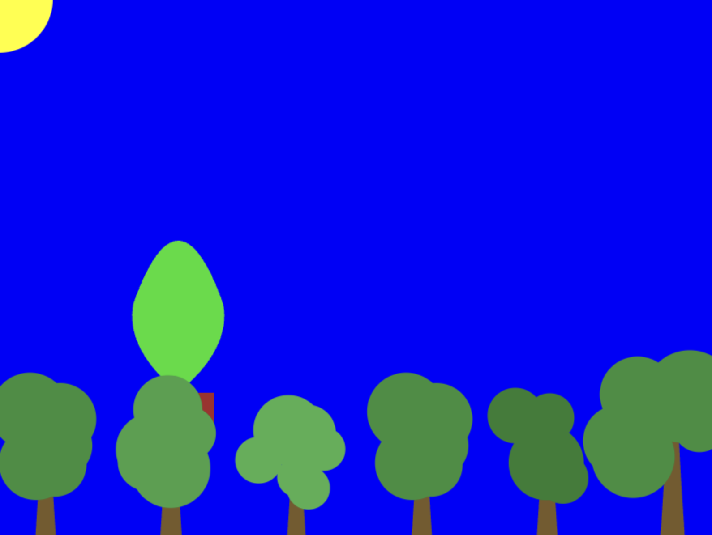

# Step 6

Moving balloon, endless trees... Hey this is coming along nicely now! We have the basic building blocks of a game in place now. Here in step 7, we're going to look at what we have and clean it up somewhat. This is pretty much how I work:  Make it work, make it right, make it fast.

## Update the index page

Let's edit our `index.html`, as we always do:

```html
.
.
    <title>GoDom Tutorial Step 7</title>
.
.
```

## Cleaning things up a bit.

Right now, our `main.go` is a bit messy, to be honest. I'm going to create a new file called `game.go` that we will use to better organise things and make it simpler and easier to maintain later as well. Our biggest challenge of course that our game variables, like the balloon position and tree state, are just kind of floating around. So we're going to tighten things up just a bit.

Let's create the `game.go` file and add a struct for our game:

```go
type BalloonGame struct {
	balloonStatus BalloonStatus
	treeManager   TreeManager
	ctx           dom.Context2D
}
```

We want to keep track of the balloon status (position), the trees and remember our graphics context. With all of that, we should be able to render our game scene. Right, we'll need some functions to act on the game of course. First one we need is one that will create out new game, so:

```go
func NewGame(ctx dom.Context2D) *BalloonGame {
	game := &BalloonGame{
		balloonStatus: BalloonStatus{X: 200, Y: 200},
		treeManager:   *NewTreeManager(),
		ctx:           ctx,
	}
	return game
}
```

We create a `NewGame` function that takes the Context2D as an argument, creates a new game instance, populates it and returns a handle to it. Nothing here is new or surprising, we're' just putting stuff together. We are just neatening things up a tad.

We will also need a way to set the state of the balloon, is it rising or not? And then we need to draw the background, the balloon, the trees and of course update everything each tick. Let's go ahead and put some functionality in place for all of this:

```go
func (b *BalloonGame) IsRising(state bool) {
	b.balloonStatus.IsRising = state
}

func (b *BalloonGame) drawGameBackground() {
	b.ctx.ClearRect(0, 0, canvasWidth, canvasHeight)
	b.ctx.FillStyle("yellow")
	b.ctx.BeginPath()
	b.ctx.Arc(0.0, 0.0, 60.0, 0.0, 180.0, false)
	b.ctx.Fill()
}

func (b *BalloonGame) render() {
	b.drawGameBackground()
	drawBalloon(b.balloonStatus, b.ctx)
	b.treeManager.Render(b.ctx)
}

func (b *BalloonGame) Tick() {
	b.balloonStatus.Update()
	b.treeManager.Update()
	b.render()
}
```

Ok so we create a `IsRising` public function, which allows us to affect the internal state of the balloon. We then have two private functions to handle the rendering, because that's just called by our `Tick` function, nobody outside needs to know about these. On each call to `Tick`, we update the balloon and tree states and render everything. Nice!

In `main_event_handlers.go`, we will need to change our `registerCanvasEventHandlers` function because we're putting the balloon state inside our struct, so update it like this:

```go
func registerCanvasEventHandlers(canvas html.Element, game *BalloonGame) {
	var pointerDown, spaceDown bool

	syncRising := func() {
		game.IsRising(pointerDown || spaceDown)
	}
.
. // the rest stays the same
.
```

We take in a handle to our game and call the newly created `IsRising` function on our game struct. And just like that, events are hooked in. Pretty simple. What remains is a change to `main.go` of course:

```go
package main

import "github.com/ewaldhorn/godom/dom"

const (
	canvasWidth  = 800
	canvasHeight = 600
)

func main() {
	dom.Init()

	myCanvas, context2d := createAndConfigureHTMLCanvas()
	game := NewGame(context2d)
	registerCanvasEventHandlers(myCanvas, game)

	stopLoop := dom.StartLoop(func() {
		game.Tick()
	})
	defer stopLoop()

	select {}
}
```

It's a lot shorter and simpler now! Look we create the canvas and graphics context, then the game (which requires the graphics context) and then the event handlers (which require the game) and then we just call the game `Tick` on every frame update. You might have noticed I made the sun a little smaller... Did you? Let's run it!

You should get this in your browser:



If you run into issues, check your code against the repo, we made a lot of changes!

## That's it for this one

Let's go to Step 8 when you are ready:  [Step 8](../step_8/)
